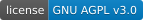

<!-- prettier-ignore -->
<div align="center">

# Nicholas M. Synovic — Resume

_LaTeX source for my resume, with modular sections, BibLaTeX-managed publication records, and automated PDF and DOCX builds through GitHub Actions._

[](LICENSE)

[Website](https://nicholassynovic.github.io/) · [LinkedIn](https://www.linkedin.com/in/nsynovic) · [GitHub](https://github.com/NicholasSynovic)

[Downloads](#downloads) • [Build Locally](#build-locally) • [Updating the Resume](#updating-the-resume) • [License](#license)

</div>

## Downloads

Two GitHub Actions workflows build the resume on every push and pull request, and can also be triggered manually:

- [Compile Resume](https://github.com/NicholasSynovic/resume/actions/workflows/build-pdf.yml) compiles `main.tex` and uploads the PDF as the `curriculum-vitae` artifact.
- [Compile Resume DOCX](https://github.com/NicholasSynovic/resume/actions/workflows/build-docx.yml) converts the source to DOCX with Pandoc and uploads it as the `curriculum-vitae-docx` artifact.

To download a compiled copy:

1. Open the workflow and select a successful run.
2. Download the artifact.
3. Extract the archive to access `NicholasMSynovic_resume.pdf` or `NicholasMSynovic_resume.docx`.

Artifacts are retained for 30 days.

> [!NOTE]
> Pushing a Git tag publishes both files to a [GitHub Release](https://github.com/NicholasSynovic/resume/releases).

## Contents

The resume includes sections covering:

- Experience
- Education
- Selected Publications
- Technical Skills

## Repository Structure

```text
.
├── .github/
│   └── workflows/
│       ├── build-pdf.yml    # Automated PDF compilation and release uploads
│       └── build-docx.yml   # Automated DOCX compilation and release uploads
├── bibliography/            # BibLaTeX data for Selected Publications
│   ├── conferences.bib
│   ├── journals.bib
│   ├── preprints.bib
│   └── presentations.bib
├── docs/
│   └── license_badge.svg    # License badge referenced by this README
├── misc/
│   └── typesetting.tex      # Packages, formatting, and reusable commands
├── scripts/
│   └── build_docx.py        # Converts the LaTeX source to DOCX with Pandoc
├── sections/                # Individual resume sections
├── LICENSE
├── main.tex                 # Document entry point and contact information
└── README.md
```

Content and presentation are maintained separately: `main.tex` assembles the document, `sections/` holds the resume entries, and `misc/typesetting.tex` controls the layout.

## Build Locally

### Requirements

Install a LaTeX distribution with:

- pdfLaTeX
- `latexmk`
- Biber
- The packages used by the document: `geometry`, `fontenc`, `titlesec`,
  `enumitem`, `xurl`, `biblatex`, and `hyperref`

The bibliography uses BibLaTeX with the Biber backend.

The DOCX build additionally requires Python 3 and Pandoc on the `PATH`; the DOCX workflow pins Pandoc 3.14.

### Compile

Clone the repository and build from its root directory:

```sh
git clone https://github.com/NicholasSynovic/resume.git
cd resume

latexmk -pdf -file-line-error -halt-on-error -interaction=nonstopmode main.tex
```

The compiled document is written to `main.pdf`.

Alternatively, compile explicitly:

```sh
pdflatex -interaction=nonstopmode -halt-on-error main.tex
biber main
pdflatex -interaction=nonstopmode -halt-on-error main.tex
pdflatex -interaction=nonstopmode -halt-on-error main.tex
```

### Build the DOCX

From the repository root:

```sh
python3 scripts/build_docx.py
```

The script expands all `\input{...}` files, renders each bibliography `refsection` through Pandoc's citeproc, and writes `main.docx`.

### Clean Build Files

Remove intermediate compilation files while keeping the PDF:

```sh
latexmk -c main.tex
```

## Updating the Resume

### Content

Edit the corresponding `.tex` file in `sections/`. To add or reorder sections, update the `\input{sections/...}` statements in `main.tex`.

Contact information and profile links are defined directly in `main.tex`.

### Publications

Selected Publications cites explicit entry keys with `\nocite` inside a `\begin{refsection}[...]` block that lists the bibliography files to use — currently `bibliography/conferences.bib` and `bibliography/preprints.bib`. To add a publication, add an entry to the relevant `.bib` file and list its key in `\nocite`. Other bibliography files, such as `journals.bib` and `presentations.bib`, can be included the same way.

Bibliography entries are sorted by year descending, then name and title. DOI links are enabled; when an entry has a DOI, its URL field is suppressed in the rendered bibliography.

### Formatting

Edit `misc/typesetting.tex` to change margins, headings, list spacing, bibliography formatting, or reusable commands.

The document uses an 11-point article layout on US letter paper with 0.75-inch margins.

The `\cventry` command formats an institution or employer, location, position or degree, and dates:

```tex
\cventry
    {Institution or Employer}
    {Location}
    {Position or Degree}
    {Dates}
```

## Continuous Integration

GitHub Actions compiles `main.tex` using `xu-cheng/latex-action` and uploads the resulting PDF as the `curriculum-vitae` artifact.

If compilation fails, available `main.log` and `main.blg` files are uploaded as `latex-build-logs`, and the DOCX build uploads `main-docx.log` as `docx-build-logs`; both are retained for 7 days.

See [the PDF workflow configuration](.github/workflows/build-pdf.yml) and [the DOCX workflow configuration](.github/workflows/build-docx.yml) for build settings.

## License

This repository includes the GNU Affero General Public License, version 3. See [LICENSE](LICENSE) for the full terms.
